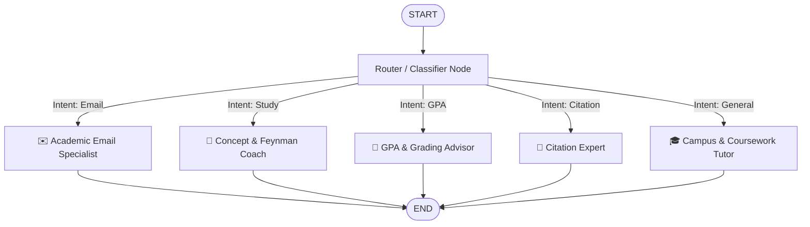

# 🎓 UniBot - University AI Assistant powered by LangGraph

A simple, modular, and lightweight **AI-powered student assistant** built with **LangGraph** (`StateGraph`) specifically designed for college and university students.

> 📦 **Ultra-Lightweight on GitHub:** The entire codebase is **under 100 KB** (< 0.1 MB) — comfortably beneath GitHub's 25 MB file limit. Configured with `.gitignore` to prevent any dependency bloat.

---

## 🧠 LangGraph Architecture

UniBot uses LangGraph's state machine to classify student inquiries and conditionally route them to domain-specific specialist nodes:



### LangGraph Nodes in [graph.py](graph.py):
1. **`router`**: Inspects user input and categorizes intent (`email`, `study`, `gpa`, `citation`, `general`).
2. **`email_agent`**: Generates polite emails to professors (deadline extensions, office hours, letters of recommendation).
3. **`study_agent`**: Breaks down lecture topics using the Feynman Technique, Active Recall, and 50/10 Pomodoro intervals.
4. **`gpa_agent`**: Calculates semester GPA / CGPA using 4.0 weighted credit math.
5. **`citation_agent`**: Generates citations for APA 7th, MLA 9th, Chicago, and IEEE styles.
6. **`general_agent`**: General academic guidance, syllabus questions, and campus survival tips.

---

## 🌟 Student Features

- ✉️ **Professor Email Generator:** Polite templates for assignment extensions, office hours, LORs, and grade inquiries.
- 🧮 **GPA Calculator:** 4.0 scale weighted credit calculations and grade conversion tables.
- 📖 **Citation Formatter:** Accurate formats for APA, MLA, and IEEE references.
- 🎯 **Feynman Study Technique:** Explains difficult topics in simple terms with everyday analogies.
- 🤖 **Dual-Engine Execution:**
  - **Live LangGraph + LLM:** Connect free Google Gemini (`gemini-2.5-flash`) or OpenAI.
  - **Offline Campus Fallback:** Includes built-in knowledge responses so it works even if you don't have an API key!
- 🌓 **Dark & Light Mode:** Eye-friendly UI optimized for late-night study sessions.

---

## 🚀 Getting Started

### 1. Install Dependencies
```bash
pip install -r requirements.txt
```

### 2. Configure API Key (Optional)
Copy `.env.example` to `.env` and add your free Google Gemini API key:
```env
GEMINI_API_KEY=your_gemini_api_key_here
```
*(You can get a free key from [Google AI Studio](https://aistudio.google.com/app/apikey). You can also enter it directly in the web UI settings!)*

### 3. Run UniBot

#### Option A: Web App (Recommended)
```bash
python app.py
```
Open **`http://localhost:3000`** in your browser.

#### Option B: Terminal CLI
```bash
python cli.py
```

#### Option C: Standalone Zero-Install
Double-click `index.html` in your file manager to open the frontend directly in your browser.

---

## 📤 How to Upload to GitHub (Step-by-Step)

The project includes `.gitignore` so your virtual environments (`.venv/`), caches (`__pycache__/`), and `.env` files are never committed, keeping the repository size tiny (< 100 KB):

```bash
# 1. Initialize Git (if not already initialized)
git init

# 2. Stage all files
git add .

# 3. Commit
git commit -m "feat: LangGraph university student chatbot"

# 4. Link to your GitHub repository
git branch -M main
git remote add origin https://github.com/YOUR_USERNAME/unibot-langgraph.git

# 5. Push to GitHub
git push -u origin main
```

---

## 📁 Repository Structure

```text
├── graph.py            # LangGraph StateGraph workflow & specialist nodes
├── app.py              # Flask server integrating LangGraph with web UI
├── cli.py              # Interactive command-line interface for the graph
├── campus-ai.js        # Offline university knowledge fallback engine
├── index.html          # Modern student chat web interface
├── styles.css          # Dark & light mode CSS
├── app.js              # Client-side UI logic & API handling
├── server.js           # Optional zero-dependency Node.js server
├── requirements.txt    # Python dependencies (langgraph, langchain-core, etc.)
├── .env.example        # Environment variable template
├── .gitignore          # Keeps repository size < 100 KB on GitHub
└── README.md           # Documentation
```

---

## 📄 License
MIT License - Free for all students and educators to use, modify, and build upon.
